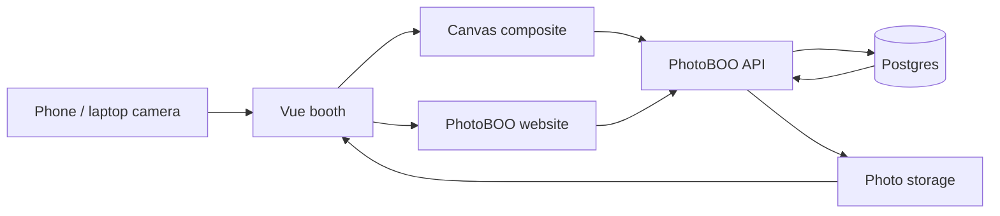

# PhotoBOO — Private Worlds, Shared Themes, Keepable Strips

**A friend-group photobooth you can actually host for free.**

> PhotoBOO turns a phone camera into a four-frame booth: pick a world, put your face on a character, decorate the strip, and take home a PNG that looks like the preview. No accounts. No app store. A 6-character code is the invitation.

**Website:** [add your Vercel link here](https://your-app.vercel.app)

---

## Executive summary

Most “online photobooths” are either a one-off webcam toy or a party product that vanishes when the tab closes. PhotoBOO is built for a small group that wants a shared night — a theme everyone sees, a lobby that updates when someone joins, and strips that stay online after the host’s laptop sleeps.

It does four things well:

1. **Shoot without signing up.** `/photobooth` works alone. A World is optional.
2. **Give the group a room.** Create a World, send the 6-character code, pick a theme. Everyone sees the same art and the same gallery.
3. **Composite in the browser.** Four frames, character art, stickers, and ink flatten to one PNG on the device. The API stores; it does not redraw.
4. **Keep data off the website host.** Postgres and photos live in Supabase, so strips survive after you close the tab.

The current catalog is **8 themes, 10 Kahoot-style characters per theme, 8 themed stickers, and 16 global “Everyday” stickers**. Geometry is checked by `npm test`.

---

## Who it is for

**Primary users — a host and their friends**

- One person creates a World on a laptop or phone and reads the code out loud
- Everyone else opens the same website, types the code, and picks a name
- There are no emails, passwords, or app installs
- A host may keep up to **15 Worlds**; Worlds you only joined do not count against that

**A solo visitor** can skip the lobby entirely: **Just open the photobooth**.

**Nobody else** needs an account. Member identity is a bearer token minted at create/join time and stored in that browser’s `localStorage`. The server stores only the SHA-256 hash.

---

## Product walkthrough

### 1. Land

`/` is the home screen.

- Rejoin Worlds this browser already belongs to
- **Create a World** — name + host display name
- **Join a World** — 6-character code + display name
- **Just open the photobooth** — no World, no gallery, still a full shoot

Duplicate names in the same World are rejected. A World that is full (default 20 members) returns `409`.

### 2. Pick a theme, then a character

Inside a World the host chooses the theme first. Everyone else sees that theme in the lobby.

Then each person picks a character and takes a face photo. The face is cropped onto the art. Switching character **keeps the same photo** — PhotoBOO re-composites from the stored face instead of asking for another take.

Themes:

| Theme | Mood |
|---|---|
| Fish Tank | underwater pals |
| Farm Day | barn-yard |
| Dress to Impress | runway |
| Space Cadet | orbit |
| Café Days | latte and vinyl |
| Arcade Night | pixel cabinet |
| Enchanted Forest | moss and fireflies |
| Y2K Mall | scrunchie, CD, flip phone |

The lobby polls `/api/worlds/:id/state`. If nothing changed it returns `304`, so an idle room is cheap.

### 3. Shoot four frames

`/photobooth` is the booth.

1. Allow the camera (`https://` or `localhost` only — phones will not work on a raw LAN IP).
2. Pick a theme (or inherit the World’s).
3. **Start the shoot** — four photos, 3-second countdown between each.
4. Decorate:
   - **Stickers** — 8 from the theme plus 16 Everyday (blush, bow, snore, shades…). Drag, resize, rotate.
   - **Draw** — freehand ink, 10 colours, adjustable brush. `Ctrl+Z` undoes a stroke; **Erase** removes whole strokes.
   - **Strip colour** — 18 presets plus a custom picker. Caption ink flips dark/light so it stays readable.
   - **Theme** — change mid-edit without losing photos. Stickers reset (they belong to the old theme); ink stays.
5. **Finish strip** — download the PNG or copy the share link.

Export is **800×2960** (2× the 400×1480 layout). Sticker and stroke positions are fractions of the strip, not pixels, so the preview matches the file.

### 4. Share and keep

- Public share page: `/s/:slug`
- World gallery lists that World’s strips
- The author, or the World host, can edit or delete a strip
- Solo strips (no World) get a one-time edit token so they stay editable without an account

Worlds are **never auto-deleted**. Only the host can remove one, and that takes the gallery with it.

### 5. Go Home

**Home** returns to the World lobby without leaving the World. Creating a new World does not overwrite the previous one.

---

## How PhotoBOO is different

### The booth never requires a World

`world_id` is nullable. Shared theme, attribution, and gallery are extras. The compositing engine does not care.

### The browser composites; the server stores

The client uploads a finished PNG plus the four source frames. The API checks magic bytes, writes the buffers to a public Storage bucket, and inserts a row. It does not run ImageMagick or redraw stickers.

### Coordinates are normalised

A sticker at `(0.5, 0.2)` is the same place on a 300px preview and on the 800×2960 export. That is why “what you see is what you download” is literal.

### Photos outlive the tab

Rows live in Postgres and files live in object storage. Closing the site does not wipe a World or its gallery.

### Secrets stay off the website

The browser never receives the database service key. `.env` is gitignored and is not in this repository.

---

## System architecture



```
Browser (Vue 3)                     API (Express)                 Supabase
─────────────────                   ─────────────                 ────────
getUserMedia ─► 4 frames
                   │
                   ▼
           canvas compositing  ──►  POST /api/photobooth/strips
           (frames + frame art       │  verify magic bytes
            + stickers → 1 PNG)      │  upload buffer  ─────────►  Storage
                                     │  insert row     ─────────►  Postgres
                                     ▼
                              { shareUrl }
```

### Architectural principles

1. **Worlds are optional** — standalone booth first.
2. **Client owns pixels** — server owns persistence and authz.
3. **Tokens, not accounts** — hashed member tokens; hashed strip edit tokens.
4. **Host is the only janitor** — no TTL on Worlds.
5. **Stateless compute** — any API instance can serve any request.
6. **Honest scope** — a friend-group booth, not a public social network.

### Data

Postgres tables (paste `server/src/db/schema.pg.sql` into the Supabase SQL editor):

- `themes`, `characters`, `stickers`
- `worlds`, `members`
- `photo_strips`

Storage prefixes in the public `photobooth` bucket:

- `strips/` — finished composites
- `frames/` — the four source photos
- `characters/` — face-on-character images
- `faces/` — uncropped photos used to re-composite

Theme SVG art is served with the website (`/assets/themes/...`), not from the photo bucket.

### API surface

- `GET /api/health` — liveness
- `GET /api/themes` — active themes with characters and stickers
- `POST /api/worlds` — create World + host
- `GET /api/worlds/code/:code` — lookup
- `POST /api/worlds/code/:code/members` — join
- `GET /api/worlds/:id/state` — lobby poll (`304` when idle)
- `PATCH /api/worlds/:id` — host sets theme
- `DELETE /api/worlds/:id` — host destroys World and gallery
- `POST /api/members/character` — save / swap character
- `GET /api/worlds/:id/strips` — gallery
- `POST /api/photobooth/strips` — create strip
- `PATCH /api/photobooth/strips/:id` — re-export decorations
- `DELETE /api/photobooth/strips/:id` — remove
- `GET /api/photobooth/strips/:slug` — public share payload

---

## Technology stack

**Website**

- Vue 3, Vue Router, Pinia
- Vite 5
- Bootstrap 5 + Bootstrap Icons
- Browser `getUserMedia` and `<canvas>` 2D

**API**

- Node.js 20+
- Express 4
- Multer (memory uploads)
- Zod
- `@supabase/supabase-js`

**Data**

- Supabase Postgres
- Supabase Storage (public `photobooth` bucket, 1 GB on the free tier)

**Art**

- SVG generated from `tools/themes.mjs` and `tools/stickers-global.mjs`
- No paid icon or photo APIs

---

## Local setup

### Prerequisites

- Node.js 20 or later
- npm
- a free [Supabase](https://supabase.com) project (local and production use the same one)

### 1. Create the Supabase project

1. New project → wait until it is ready.
2. **Project Settings → API** — copy **Project URL** and the **`service_role`** secret. Do not use the `anon` key on the server.
3. **SQL Editor** — paste `server/src/db/schema.pg.sql` → **Run**. That creates tables, the public `photobooth` bucket, and a public-read policy.
4. **Storage → photobooth** — allow CORS `GET` and `HEAD` from `*` (or your website origin). Without this, canvas export throws a SecurityError.

### 2. Configure `server/.env` — never commit this file

```powershell
Copy-Item server\.env.example server\.env
```

```ini
PORT=3000
PUBLIC_URL=http://localhost:5173
ALLOWED_ORIGINS=http://localhost:5173
SUPABASE_URL=https://xxxxxxxx.supabase.co
SUPABASE_SERVICE_ROLE_KEY=eyJ...
SUPABASE_BUCKET=photobooth
```

`.gitignore` blocks `.env`, `.env.local`, and `**/.env`. Only `.env.example` files are in git. If git ever offers to add `server/.env`, refuse.

### 3. Install, seed, run

```powershell
npm run setup     # install, generate SVG art, seed Supabase
npm run dev       # API :3000 + website :5173
```

Open [http://localhost:5173](http://localhost:5173).

| Command | What it does |
|---|---|
| `npm run dev` | API and website together |
| `npm run setup` | First-time install + assets + seed |
| `npm run assets` | Regenerate SVG art from `tools/` |
| `npm run seed` | Upsert themes / characters / stickers |
| `npm test` | Geometry unit tests |
| `npm run build` | Production client → `client/dist/` |

`IMAGE_SERVICE_URL` is an optional compressor. Leave it blank. The app works without it.

### Adding a theme

Themes are data. Copy an object in `tools/themes.mjs`, change colours and shapes, append it to `THEMES`. Frames must stay **transparent** — an opaque frame hides the strip-colour picker. Shared stickers go in `tools/stickers-global.mjs`.

```powershell
npm run assets
npm run seed
```

---

## Repository structure

```text
PhotoBOO/
├── client/                       # Vue 3 website
│   ├── src/lib/                  # compositing engine (unit tested)
│   │   ├── layout.js             # strip geometry
│   │   ├── composite.js          # frames + art + ink + stickers
│   │   ├── geometry.js           # normalised ↔ pixel
│   │   ├── crop.js               # circular face onto a character
│   │   ├── imageLoader.js        # decoded-image cache, CORS-safe
│   │   └── canvas.js             # OffscreenCanvas + Safari fallback
│   ├── src/stores/               # Pinia — booth + World
│   ├── src/views/                # landing, booth, lobby, share
│   └── public/assets/themes/     # committed SVG art
├── server/                       # Express API
│   ├── src/routes/
│   ├── src/services/
│   ├── src/repos/
│   ├── src/adapters/             # Storage + optional optimiser
│   ├── src/db/schema.pg.sql      # database schema
│   └── .env.example              # copy to .env — do not commit .env
└── tools/                        # SVG generators + combined dev runner
```

---

## Troubleshooting

| Symptom | Cause and fix |
|---|---|
| Camera blocked | Allow it in the address-bar icon, then **Try again** |
| Camera works nowhere | Must be `localhost` or `https://` |
| `ERR_CONNECTION_REFUSED` on :5173 | From the repo root: `npm run dev` |
| Could not load themes | The API is not running — from the repo root, `npm run dev` |
| API exits mentioning `SUPABASE_URL` | Fill `server/.env` with Project URL + **service_role** |
| Seed / API RLS errors | You used the `anon` key |
| Canvas SecurityError on export | Storage CORS: allow `GET`/`HEAD` from `*` |
| Fresh start | From `server/`: `npm run reset` (wipes Worlds and photos, keeps themes) |

---

## Current scope

PhotoBOO is a friend-group side project on free tiers.

- No user accounts or password reset
- Identity lives in one browser’s `localStorage`; another device needs the join code again
- There is no moderation queue; this is meant for people you already know
- Theme art is generated SVG, not licensed photography
- The optional EXIF-stripping sidecar is off by default

---

## Product thesis

The booth people will actually use is the one that does not ask them to install anything, does not delete last Saturday’s strips when a free server falls asleep, and prints a file that looks like the screen they were decorating.

> **The browser shoots. The group shares a code. The strip you decorated is the file you take home.**
